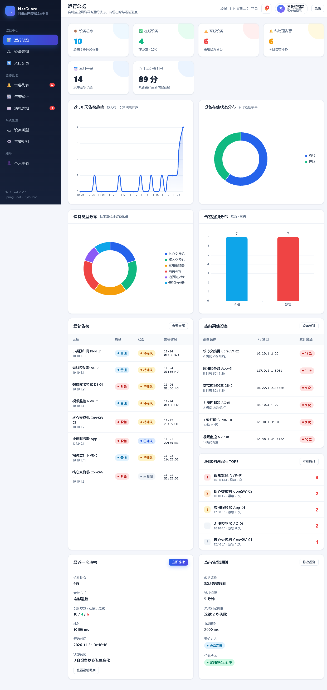
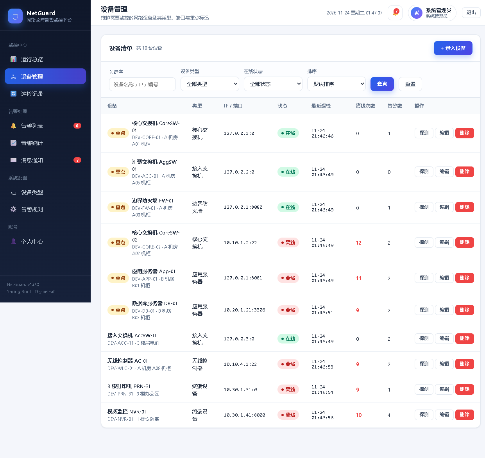

# NetGuard 网络故障告警监控平台

> 期末综合大作业 · 题目七（★★★★☆）　Spring Boot 2.7.18 + Thymeleaf + MyBatis-Plus + MySQL 8 + Redis + RabbitMQ + Spring Security
>
> 仓库地址：https://github.com/mylr1luolin-cyber/netguard-alarm-platform

NetGuard 面向企业网络运维场景，提供设备台账、自动巡检、故障告警、处理闭环、统计分析、规则配置的一体化监控能力：设备连续探测失败达阈值即判定离线并生成告警，按"是否重点设备"区分紧急/普通级别，通过页面通知与邮件异步推送；设备恢复在线时自动发送恢复通知并回填故障持续时长；所有告警可按时间范围检索、按设备排行、按月出图。

## 功能一览

| 模块 | 能力 |
| --- | --- |
| 设备注册管理 | 名称、IP、类型、监控端口（0 = ICMP，其余 = TCP）、位置、备注、设备图片；在线/离线/未知标识；编辑、删除、立即探测 |
| 定时巡检 | 间隔可配 5/10/30 分钟，逐台 TCP 端口或 ICMP Ping 探测，结果写 `inspect_log`/`inspect_detail`，实时状态写 Redis（缺失自动降级内存） |
| 故障告警 | 连续失败达阈值触发告警；重点设备 + 规则开启 → 紧急，否则普通；RabbitMQ 异步通知（页面 + 邮件），恢复在线自动闭环 |
| 告警处理 | 列表多条件检索（关键字/级别/状态/类型/时间范围），确认告警并记录处理情况，处理进度时间线 |
| 历史统计 | 每日趋势、级别分布、月度柱状、设备故障次数排行 TOP10、平均处理时长 |
| 规则配置 | 巡检间隔、失败阈值、探测超时、紧急告警开关、页面/邮件通知开关与收件人；保存后热更新巡检调度，无需重启 |
| 系统与权限 | ADMIN（设备增删改、类型与规则配置）/ OPS（查看 + 确认告警）；BCrypt 密码、CSRF、会话互斥 |

## 技术栈

| 层 | 技术 |
| --- | --- |
| 运行环境 | JDK 17、Maven 3.9、Spring Boot 2.7.18 |
| Web / 视图 | Spring MVC、Thymeleaf 3.0（服务端渲染，无前端框架）、自写 CSS、原生 JS、ECharts 5.4.3（本地） |
| 持久层 | MyBatis-Plus 3.5.5（单表 CRUD + XML 动态 SQL + 分页） |
| 数据库 | MySQL 8.0（utf8mb4） |
| 缓存 | Redis（设备实时状态 Hash、看板汇总），不可用时自动降级内存 |
| 消息 | RabbitMQ（告警通知异步化，含死信队列），可切换本地同步降级 |
| 安全 | Spring Security 5.7（表单登录、角色鉴权、CSRF、会话互斥） |
| 定时 | Spring Task + ThreadPoolTaskScheduler（支持运行时改间隔） |
| 邮件 | Spring Mail（JavaMailSender）+ 异步线程池 |

## 快速开始

### 0. 一键启动（最省事）

双击项目根目录的 **`一键启动.bat`**，它会自动完成：起 MySQL → 检查 `target/netguard.jar` 是否比源码新（旧了就重新编译）→ 启动服务 → 等 8080 就绪后打开浏览器。

- 首次或改过代码：双击后自动编译（约 20 秒），之后启动只要 10 秒左右
- 强制重新编译：命令行运行 `一键启动.bat build`
- 停止服务：双击 **`一键停止.bat`**（只停应用，不停 MySQL），或直接关掉标题为「NetGuard 服务」的窗口
- **JDK 自动查找**：脚本不再写死 JDK 路径，启动时按 `JAVA_HOME` → 注册表（Oracle/Adoptium/Corretto/Zulu/JBR…）→ `PATH` → 常见安装目录（含 `C:\devtools`、`D:\devtools`、`~/.jdks`）→ 全盘扫描的顺序找 JDK，并实际读 `release`/`java -version` 校验版本
- **Maven / MySQL 也自动识别**：先看脚本开头的默认目录，找不到就查 `PATH` 上的 `mvn` / `mysqld`；换一台机器（比如服务器）只要 3306 能连、`target/netguard.jar` 在，**没有 Maven 也能直接把服务跑起来**（源码比 jar 新时会提示"跳过编译，使用现有 jar"）
- 覆盖路径：运行前 `set NG_JAVA_HOME=...`、`set NG_MVN_HOME=...`、`set NG_MYSQL_HOME=...`，不用改脚本
- 只看本机装了哪些 JDK：双击 **`tools\查找JDK.bat`**，会列出所有 JDK 的路径/版本/来源并标出推荐项

### 1. 环境要求

- JDK 17
- Maven 3.9+
- MySQL 8.0（本地 3306，账号 `root/123456`；如不同请改 `src/main/resources/application-dev.yml`）
- Redis / RabbitMQ / SMTP **可选**：缺失时自动降级（内存缓存、本地同步通知、跳过邮件）

### 2. 初始化数据库

```bash
mysql -u root -p123456 --default-character-set=utf8mb4 < sql/netguard.sql
```

脚本会创建 `netguard` 库、9 张表、索引与外键，并写入每表 ≥5 条测试数据、默认账号与默认规则。

### 3. 构建与启动

```bash
# 构建
mvn -B -DskipTests package

# 启动（开发环境：MQ 与邮件关闭，Redis 缺失自动降级）
java -jar target/netguard.jar --spring.profiles.active=dev
```

Windows 可直接双击 `start-dev.bat`（JDK 自动查找；本机找不到时会提示安装命令）。

### 4. 用 IDEA 打开（推荐）

项目是标准 Maven 工程，IDEA 可以直接运行，不需要额外装配：

1. `File → Open` 选择项目根目录 `D:\企业管理`（识别到 `pom.xml` 后按 Maven 工程导入）；
2. `File → Project Structure → Project SDK` 选 JDK 17（可用本机的 `D:\devtools\jdk17\jdk-17.0.2`）；
3. 首次导入等 Maven 依赖下载完；想快点可在 `Settings → Build Tools → Maven` 把 Maven home 指向 `D:\devtools\maven\apache-maven-3.9.9`、User settings file 指向它的 `conf\settings.xml`（已配阿里云镜像、本地仓库 `D:\devtools\m2repo`）；
4. 先启动数据库：双击 `start-mysql.bat`（或手动运行 `mysqld --defaults-file=...\my.ini`）；
5. 右上角运行配置选「NetGuardApplication（dev）」（`.run/NetGuardApplication.run.xml` 已带 `--spring.profiles.active=dev` 与 `-Dfile.encoding=UTF-8`），点绿三角；也可以直接打开 `NetGuardApplication.java` 右键 `Run`；
6. 控制台出现 `Tomcat started on port(s): 8080` 后访问 http://localhost:8080 。

两个常见坑：Lombok 需要开注解处理（IDEA 2020.3 之后默认开启；若实体类 getter 报红，去 `Settings → Build, Execution, Deployment → Compiler → Annotation Processors` 勾选 `Enable annotation processing`）；MySQL 没起时启动会报 `Communications link failure`，先跑第 4 步。

### 5. 访问

- 地址：http://localhost:8080
- 管理员：`admin / admin123`（设备增删改、类型管理、规则配置）
- 运维人员：`ops / ops123`（查看设备与告警、确认告警、手动巡检）

> 演示数据中部分设备指向本机回环地址与本地端口（`127.0.0.1:8080` 等），以便在单机环境同时展示"在线"与"离线/告警"两种状态；其余设备使用真实网段地址，探测超时后按规则产生告警。

## 目录结构

```
D:\企业管理
├── src/main/java/com/netguard      后端源码（common/config/controller/dto/entity/exception/mapper/mq/query/security/service/task/utils/vo）
├── src/main/resources
│   ├── application*.yml            多环境配置（dev / test / prod）
│   ├── mapper/*.xml                动态 SQL
│   ├── templates/                  Thymeleaf 页面（15 个 + fragments/layout.html）
│   └── static/                     css / js / echarts
├── sql/netguard.sql                建库 + 建表 + 测试数据 + 账号
├── docs/                           11 份开发标准文档 + 答辩演讲稿
├── deploy/                         nginx.conf / netguard.service / deploy.sh / README
├── 开发日志/                        每日开发记录（完成事项 + 待办）
├── 截图/                            运行界面截图
├── start-dev.bat                   Windows 一键启动
├── start-mysql.bat                 启动便携版 MySQL（IDEA 调试前先跑它）
├── .run/                           IDEA 共享运行配置
├── CLAUDE.md                       标准文件索引与工作说明
└── pom.xml
```

## 文档索引

| 文档 | 内容 |
| --- | --- |
| [01-需求分析说明书](docs/01-需求分析说明书.md) | 背景、角色、功能需求、用例、验收标准 |
| [02-技术架构与选型说明](docs/02-技术架构与选型说明.md) | 选型理由、分层架构、关键设计决策、包结构 |
| [03-数据库设计说明书](docs/03-数据库设计说明书.md) | ER 图、9 张表字段字典、索引、初始化数据 |
| [04-接口与页面设计规范](docs/04-接口与页面设计规范.md) | 路由总表、JSON 契约、表单校验、模板规范 |
| [05-编码规范](docs/05-编码规范.md) | 命名、分层、注释、日志、提交规范 |
| [06-安全设计规范](docs/06-安全设计规范.md) | 认证授权、CSRF、注入/XSS、上传安全 |
| [07-开发执行步骤与里程碑](docs/07-开发执行步骤与里程碑.md) | 阶段计划、模块顺序、风险应对 |
| [08-测试用例与验收标准](docs/08-测试用例与验收标准.md) | 40+ 测试用例、验收清单、缺陷记录 |
| [09-部署运维手册](docs/09-部署运维手册.md) | Linux/Nginx/systemd 部署、备份、排障 |
| [10-项目开发文档](docs/10-项目开发文档.md) | 交付物、完成度、分工、里程碑、演示脚本 |
| [11-公网部署指南](docs/11-公网部署指南.md) | 云服务器选型、安全组、MySQL 建库、Nginx、域名、HTTPS、上线验收 |

部署相关：[deploy/README.md](deploy/README.md)　开发日志：[开发日志/README.md](开发日志/README.md)

## 界面预览

| 看板 | 设备管理 |
| --- | --- |
|  |  |

## 常见问题

1. **启动报数据库连接失败**：确认 MySQL 已启动、`netguard` 库已导入、`application-dev.yml` 中账号密码正确。
2. **日志出现 `Redis 不可用，已自动降级为本地内存缓存`**：属预期行为，未安装 Redis 时使用内存缓存，每 60 秒自动重连。
3. **中文乱码**：构建与启动均需 `-Dfile.encoding=UTF-8`（`start-dev.bat` 已内置）。
4. **端口 8080 被占用**：`java -jar target/netguard.jar --server.port=8081`。
5. **邮件未发送**：dev 环境 `app.mail.enabled=false`，通知记录状态为 `SKIPPED`；生产环境配置 SMTP 后开启即可。
6. **登录一直提示"账号或密码错误"**：先确认 `sys_user` 里有数据，并看密码长度对不对——
   `mysql -u root -p123456 -D netguard -e "SELECT username, role, status, LENGTH(password) AS len, LEFT(password,7) AS pwd_prefix FROM sys_user;"`
   正常是 `len=60`、`pwd_prefix=$2a$10$`。空表说明数据库脚本没导入（见「2. 初始化数据库」）；
   `len` 是 8、14 这类短值，说明 BCrypt 串被 shell 的 `$` 展开截断了——**不要**把带 `$` 的 SQL 粘到
   双引号里执行，直接双击 `tools/修复登录.bat`（内部用 `mysql < 文件` 导入，不会被展开）。
   若表存在但没有 `admin`，应用启动时会自动补建 `admin/admin123` 并在日志里打印「账号自检：…」；
   反过来，启动时若发现密文非法（长度≠60 或不是 `$2a$` 开头），也会自动重置为默认密码并打 WARN。
7. **换了台机器/服务器，启动脚本报找不到 JDK、Maven 或 MySQL**：`一键启动.bat` 会自动查找，
   也可用 `NG_JAVA_HOME` / `NG_MVN_HOME` / `NG_MYSQL_HOME` 覆盖；服务器上没装 Maven 时，
   把本机编译好的 `target/netguard.jar` 拷过去即可（脚本会跳过编译）。
8. **浏览器打开出现 `Whitelabel Error Page`（404）**：说明这个端口上响应的**不是本项目**，或者地址带错了。
   判断方法：访问 `http://你的地址:8080/health`——返回 `{"code":200,...,"app":"NetGuard 网络故障告警监控平台"}`
   才是本程序，同一响应里还有 `database`、`adminExists`、`adminPasswordLength` 三个字段，
   能直接看出程序连的是哪个库、admin 是否在、密文长度是否为 60。
   返回 Whitelabel 页面就说明 8080 被别的应用占用（`netstat -ano | findstr :8080` 查 PID）。
   本项目入口只有两个：`/` 和 `/login`，不要把别的系统带 `client_id`、`redirect_uri` 的回调链接粘进来。
   现在浏览器访问不存在的页面会**直接跳回看板/登录页**（接口请求仍返回 JSON 404），不会再卡在 404 上。
9. **密码忘了 / 怎么改都不对**：不用装 MySQL 客户端，双击 `tools/重置密码并启动.bat`——
   它带 `--app.reset-admin=true` 启动，开机时把 `admin` 重置为 `admin123`、`ops` 重置为 `ops123`。
   登录失败的具体原因也会写进日志（账号不存在 / 密文长度异常 / 密码不匹配 / 账号被停用）。
10. **那台机器上其实没有 MySQL**：登录页能打开只是因为它不查库，提交账号才查——查不到就把异常
    变成"账号或密码错误"，所以怎么重置都没用。确认办法：双击 `tools/查找MySQL.bat`，
    显示 `No MySQL found on this machine.` 就是这一类。处理：装 MySQL 8（`winget install Oracle.MySQL`）、
    或把便携版整目录拷到 `D:\devtools\mysql\mysql-8.0.28-winx64`、或用 `NG_MYSQL_HOME` 指路，
    然后 `start-mysql.bat` 起服务、导入 `sql/netguard.sql`，再登录。
    注意 `start-mysql.bat` / `tools/修复登录.bat` 现在都会先自动找 MySQL，**找不到时会停下来说明原因**，
    不会像旧版那样窗口一闪就关。

## 版本管理与上传

仓库：https://github.com/mylr1luolin-cyber/netguard-alarm-platform （`main` 分支）

- 常规情况：在能直连 `github.com` 的机器上 `git push origin main` 即可。
- **本机（开发机）连不上 `github.com` 的 443**（网页超时、`git push` 报 `Could not connect / Connection was reset`），
  但 `api.github.com` 正常，因此改用 Git Data API 上传：

```powershell
# 需要一枚有 Contents: Read and write 权限的 token（用完记得撤销）
powershell -NoProfile -ExecutionPolicy Bypass -File "tools\push-to-github.ps1" -Token <你的token>
```

脚本会读 `git ls-files` 的清单，把每个文件以 base64 上传成 blob（二进制无损），
再建 tree、建 commit（parent 指向远端当前 HEAD）、移动 `main` 引用，最后打印提交号。
本地改完代码先 `git add -A && git commit -m "..."`，再跑上面这条命令，远端就会与本地一致。

> 注意：`tools/*.ps1` 必须是 **UTF-8 带 BOM**，否则 PowerShell 5.1 会按 ANSI 解析，中文注释把引号配对搞乱；
> `*.bat` 则相反，必须是 **GBK(cp936) + CRLF**，否则 cmd 会把一行拆成几段报错。
