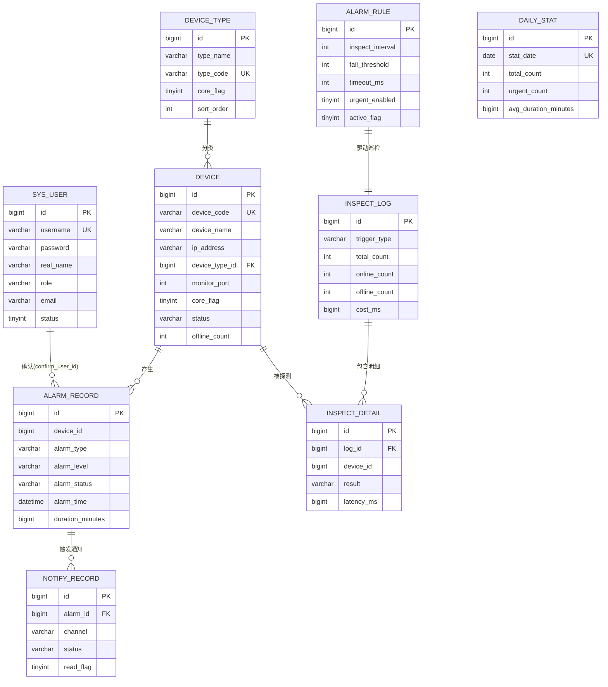

# 03 数据库设计说明书

> 数据库：MySQL 8.0　库名：`netguard`　字符集：`utf8mb4` / `utf8mb4_general_ci`
> 建表脚本：`sql/netguard.sql`　文档版本：v1.0　编写日期：2026-11-24

## 1. 设计原则

1. **单一职责**：一张表只描述一类实体，告警、通知、巡检分表存储，便于统计；
2. **适度冗余**：`alarm_record` 冗余 `device_name` / `device_ip`，`inspect_detail` 冗余设备名称与 IP，保证设备被删除后历史记录仍可读；
3. **状态用枚举字符串**（`ONLINE`/`OFFLINE`、`PENDING`/`CONFIRMED`…）而非数字，可读性优先，配合 `AlarmStatusEnum` 等枚举类；
4. **时间字段统一** `DATETIME` + `create_time` / `update_time` 自动填充（MyBatis-Plus `MetaObjectHandler`）；
5. **索引按查询路径建**：状态、时间、外键关联列均有索引，列表页分页不出现全表扫描；
6. **外键谨慎使用**：`device.device_type_id`、`inspect_detail.log_id` 建外键；`alarm_record.device_id` 不建外键，避免删除设备时阻塞历史告警。

## 2. ER 图

## 3. 表清单

| # | 表名 | 说明 | 预估数据量 |
| --- | --- | --- | --- |
| 1 | `sys_user` | 系统用户（管理员/运维） | 十级 |
| 2 | `device_type` | 设备类型字典 | 十级 |
| 3 | `device` | 设备信息 | 百级 |
| 4 | `alarm_record` | 告警记录 | 万级 |
| 5 | `notify_record` | 通知记录（页面/邮件） | 万级 |
| 6 | `inspect_log` | 巡检批次 | 万级 |
| 7 | `inspect_detail` | 巡检明细 | 百万级 |
| 8 | `alarm_rule` | 告警规则（单行） | 单行 |
| 9 | `daily_stat` | 每日统计汇总 | 千级 |

## 4. 表结构说明

### 4.1 sys_user（系统用户）

| 字段 | 类型 | 允许空 | 默认 | 说明 |
| --- | --- | --- | --- | --- |
| id | BIGINT | 否 | AUTO | 主键 |
| username | VARCHAR(50) | 否 | — | 登录账号，唯一索引 `uk_username` |
| password | VARCHAR(100) | 否 | — | BCrypt 加密密文（强度 10） |
| real_name | VARCHAR(50) | 否 | — | 真实姓名 |
| role | VARCHAR(20) | 否 | OPS | 角色：`ADMIN` / `OPS` |
| email | VARCHAR(100) | 是 | NULL | 告警邮件接收地址 |
| phone | VARCHAR(20) | 是 | NULL | 手机号 |
| avatar | VARCHAR(255) | 是 | NULL | 头像地址 |
| status | TINYINT | 否 | 1 | 1 启用 / 0 禁用（禁用后无法登录） |
| last_login_time | DATETIME | 是 | NULL | 最近登录时间（登录成功时更新） |
| create_time / update_time | DATETIME | 否 | CURRENT_TIMESTAMP | 审计字段 |

### 4.2 device_type（设备类型）

| 字段 | 类型 | 说明 |
| --- | --- | --- |
| id | BIGINT | 主键 |
| type_name | VARCHAR(50) | 类型名称，如"核心交换机" |
| type_code | VARCHAR(50) | 类型编码，唯一索引，保存时统一转大写 |
| icon | VARCHAR(50) | 图标（Emoji） |
| core_flag | TINYINT | 是否重点类别，1 是 / 0 否（仅作分类提示） |
| sort_order | INT | 排序号，默认 99，升序展示 |
| remark | VARCHAR(255) | 备注 |

### 4.3 device（设备）

| 字段 | 类型 | 说明 |
| --- | --- | --- |
| id | BIGINT | 主键 |
| device_code | VARCHAR(50) | 设备编号，唯一索引 |
| device_name | VARCHAR(100) | 设备名称 |
| ip_address | VARCHAR(50) | IPv4 地址，普通索引 `idx_ip_address` |
| device_type_id | BIGINT | 类型 ID，外键 `fk_device_type` → `device_type.id` |
| monitor_port | INT | 监控端口，0 表示使用 ICMP Ping |
| location | VARCHAR(120) | 部署位置 |
| core_flag | TINYINT | 是否重点监控（决定告警级别） |
| status | VARCHAR(20) | `ONLINE` / `OFFLINE` / `UNKNOWN`，索引 `idx_status` |
| last_check_time | DATETIME | 最近一次巡检时间 |
| last_online_time | DATETIME | 最近一次在线时间 |
| offline_count | INT | 连续探测失败次数（达到阈值触发告警） |
| image_url | VARCHAR(255) | 设备图片访问路径 |
| remark | VARCHAR(255) | 备注 |
| create_by | VARCHAR(50) | 创建人账号 |

### 4.4 alarm_record（告警记录）

| 字段 | 类型 | 说明 |
| --- | --- | --- |
| id | BIGINT | 主键 |
| device_id | BIGINT | 设备 ID（索引，不建外键） |
| device_name / device_ip | VARCHAR | 冗余设备名称与 IP |
| alarm_type | VARCHAR(20) | `OFFLINE` 设备离线 / `RECOVER` 恢复通知 |
| alarm_level | VARCHAR(20) | `URGENT` 紧急 / `NORMAL` 普通 |
| alarm_status | VARCHAR(20) | `PENDING` 待处理 → `CONFIRMED` 已确认 → `RECOVERED` 已恢复 → `CLOSED` 已关闭 |
| alarm_time | DATETIME | 告警产生时间（索引） |
| confirm_user_id / confirm_user_name | BIGINT / VARCHAR | 确认人与姓名 |
| confirm_time | DATETIME | 确认时间 |
| handle_remark | VARCHAR(255) | 处理情况说明 |
| recover_time | DATETIME | 设备恢复时间 |
| close_time | DATETIME | 关闭时间 |
| duration_minutes | BIGINT | 故障持续时长（分钟），恢复时计算 |
| notify_sent | TINYINT | 是否已发送通知 1/0 |

### 4.5 notify_record（通知记录）

| 字段 | 类型 | 说明 |
| --- | --- | --- |
| id | BIGINT | 主键 |
| alarm_id | BIGINT | 关联告警 ID（索引） |
| channel | VARCHAR(20) | `PAGE` 页面 / `MAIL` 邮件 |
| receiver | VARCHAR(255) | 页面通知为"全体运维人员"，邮件为邮箱地址 |
| title | VARCHAR(200) | 通知标题（含【紧急】前缀） |
| content | VARCHAR(1000) | 通知正文 |
| status | VARCHAR(20) | `SUCCESS` / `FAILED` / `SKIPPED` |
| error_msg | VARCHAR(255) | 失败原因（如 SMTP 未配置） |
| send_time | DATETIME | 发送时间 |
| read_flag | TINYINT | 页面通知是否已读（索引 `idx_read`） |

### 4.6 inspect_log（巡检批次）

| 字段 | 类型 | 说明 |
| --- | --- | --- |
| id | BIGINT | 主键 |
| trigger_type | VARCHAR(20) | `AUTO` 定时 / `MANUAL` 手动 |
| total_count / online_count / offline_count | INT | 设备总数与在线/离线数 |
| change_count | INT | 本次状态发生变化的设备数 |
| start_time / end_time | DATETIME | 批次起止时间（start_time 索引） |
| cost_ms | BIGINT | 总耗时（毫秒） |
| operator | VARCHAR(50) | 执行人（定时任务为 `system`） |
| remark | VARCHAR(255) | 巡检参数说明（间隔/阈值/超时） |

### 4.7 inspect_detail（巡检明细）

| 字段 | 类型 | 说明 |
| --- | --- | --- |
| id | BIGINT | 主键 |
| log_id | BIGINT | 批次 ID，外键 `fk_detail_log` → `inspect_log.id` ON DELETE CASCADE |
| device_id | BIGINT | 设备 ID（索引） |
| device_name / device_ip | VARCHAR | 冗余设备信息 |
| probe_type | VARCHAR(20) | `TCP` / `ICMP` |
| result | VARCHAR(20) | `SUCCESS` / `FAILED` |
| latency_ms | BIGINT | 探测耗时（毫秒） |
| message | VARCHAR(255) | 探测说明（如 `Connect timed out`） |
| check_time | DATETIME | 探测时间 |

### 4.8 alarm_rule（告警规则，单行配置）

| 字段 | 类型 | 说明 |
| --- | --- | --- |
| id | BIGINT | 主键（固定为 1） |
| rule_name | VARCHAR(100) | 规则名称 |
| inspect_interval | INT | 巡检间隔（分钟），只允许 5/10/30 |
| fail_threshold | INT | 连续失败阈值（1–5） |
| timeout_ms | INT | 单次探测超时（500–10000 ms） |
| urgent_enabled | TINYINT | 重点设备是否产生紧急告警 |
| notify_page_enabled | TINYINT | 页面通知开关 |
| notify_mail_enabled | TINYINT | 邮件通知开关；开启时 mail_receivers 必填 |
| mail_receivers | VARCHAR(255) | 邮件接收人，英文逗号分隔 |
| active_flag | TINYINT | 巡检开关 1 启用 / 0 暂停 |
| update_by | VARCHAR(50) | 最后更新人 |

### 4.9 daily_stat（每日统计）

| 字段 | 类型 | 说明 |
| --- | --- | --- |
| id | BIGINT | 主键 |
| stat_date | DATE | 统计日期，唯一索引 `uk_stat_date` |
| total_count / urgent_count / normal_count / recovered_count | INT | 当日告警与恢复数量 |
| avg_duration_minutes | BIGINT | 当日平均处理时长 |

## 5. 主要查询与索引对应关系

| 场景 | SQL 形态 | 命中索引 |
| --- | --- | --- |
| 设备列表分页 | `WHERE status=? AND device_type_id=? ORDER BY offline_count DESC` | `idx_status` / `idx_type` |
| 关键字搜索 | `WHERE device_name LIKE '%x%' OR ip_address LIKE '%x%'` | 无（数据量小，可接受；后续可上全文索引） |
| 告警列表 | `WHERE alarm_time BETWEEN ? AND ? ORDER BY alarm_time DESC` | `idx_alarm_time` |
| 待处理告警数 | `WHERE alarm_status='PENDING'` | `idx_alarm_status` |
| 设备故障排行 | `GROUP BY device_id` + `SUM(CASE WHEN alarm_level='URGENT')` | `idx_device` |
| 每日趋势 | `DATE_FORMAT(alarm_time,'%Y-%m-%d')` + `GROUP BY` | `idx_alarm_time` |
| 通知未读数 | `WHERE read_flag=0` | `idx_read` |
| 巡检明细 | `WHERE log_id=?` | `idx_log` |

## 6. 初始化数据说明

`sql/netguard.sql` 一次性完成：

1. 建库 `netguard`（utf8mb4）；
2. 建 9 张表（含索引与外键）；
3. 测试数据：用户 5 条、类型 7 条、设备 10 条、告警 14 条、通知 10 条、巡检批次 6 条、巡检明细 16 条、规则 1 条、日统计 10 条——**每表均 ≥5 条**；
4. 默认账号：`admin / admin123`（ADMIN）、`ops / ops123`（OPS），其余 3 个运维账号同样使用 `ops123`；
5. 时间数据使用 `NOW()` 相对偏移，导入后看板、趋势图、排行榜立即有数据，便于答辩演示。

> BCrypt 密文示例：`$2a$10$15pzQZkkHNDW0IP0Ot7cWu5UgXiIBTFIAVM3yzXTkeiPloANswCPq`（对应 `admin123`）。
> 若需重置密码，修改 `sys_user.password` 为新的 BCrypt 密文即可，禁止存明文。

## 7. 备份与容量估算

- 单条告警约 0.4 KB，单条明细约 0.3 KB；
- 100 台设备、5 分钟巡检一次：明细约 100×288 = 2.88 万条/天（约 9 MB/天）；
- 建议策略：`inspect_detail` 保留 90 天，定期归档删除；`alarm_record` 长期保留；
- 备份：`mysqldump -u root -p netguard > netguard_$(date +%F).sql`，建议每日 02:00 定时备份。
